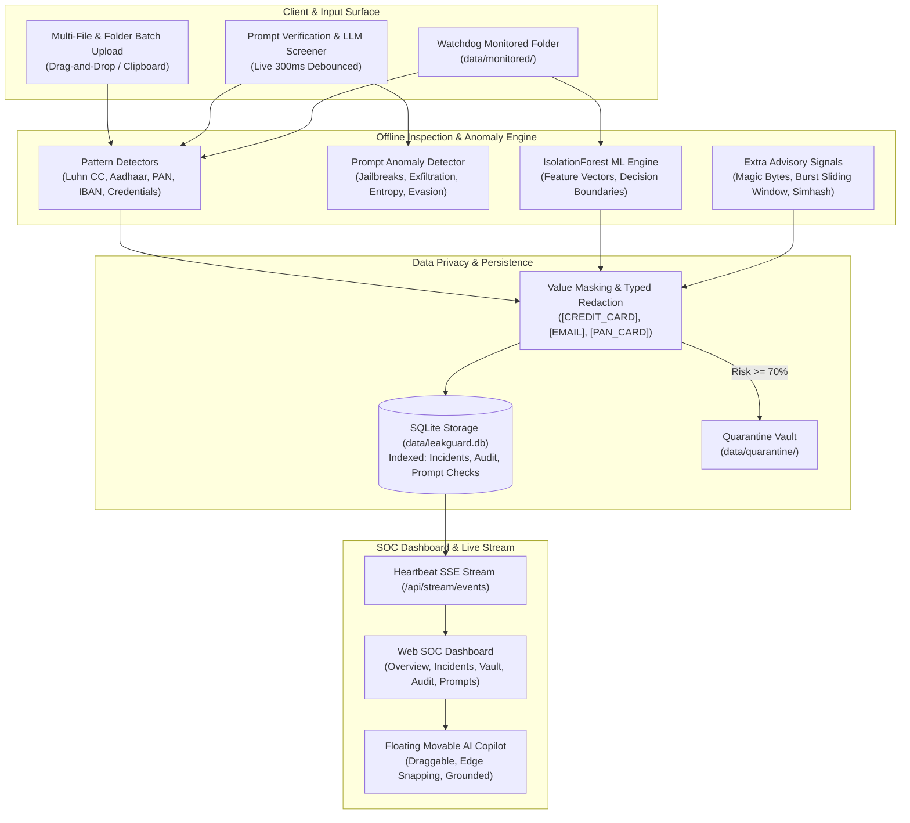

# 🔒 SentinelDLP — Production-Grade AI Data Loss Prevention Platform

> **100% Offline, Privacy-Preserving Security Operations Center (SOC) & Prompt Protection System**

SentinelDLP is an enterprise-grade cyber data protection platform that continuously safeguards files and prompts offline. It combines **Scikit-learn IsolationForest** machine learning, deterministic regex pattern detectors, and heuristic anomaly engines to detect, sanitize, quarantine, and audit data exposures in real time.

---

## 🌟 Architecture & Data Flow



---

## 🚀 Key Modules & Capabilities

### 1. Robust Core Detection & Verification
- **Luhn Check Credit Cards**: Validates Visa, MasterCard, Amex (13–19 digits).
- **National & Banking Identifiers**: Indian Aadhaar (12 digits), PAN cards, European IBANs.
- **Credential Detection**: Private key headers, AWS access keys (`AKIA...`), JWT tokens, API keys, passwords.
- **Strict Masking**: Raw values are never stored or transmitted. All entities are masked before database write, API responses, logs, and UI display.

### 2. Multi-File & Folder Upload Review (Phase 1)
- Accepts single files, multi-file selection, and **entire folder trees** (`webkitdirectory` & recursive `webkitGetAsEntry`).
- Direct clipboard pasting of text and file buffers.
- Pre-acceptance evaluation with bounded concurrency: clean files are accepted into `data/monitored/`; blocked files are never written to disk.

### 3. Prompt Security Verification & Sanitization (Phase 2)
- Real-time offline screening for LLM prompts (ChatGPT, Claude, Copilot).
- Typed placeholder redaction (`[CREDIT_CARD]`, `[EMAIL]`, `[AADHAAR]`, `[API_KEY]`).
- Instant Copy Sanitized Prompt, Export JSON / CSV report, and audit history ledger.

### 4. Prompt Anomaly & Injection Detector (Phase 3)
- **Prompt Injection & Jailbreaks**: "ignore previous instructions", DAN mode, role override, delimiter spoofing (`</system>`).
- **Data Exfiltration Intent**: Bulk customer dumps, webhook exfiltration sinks, egress URLs.
- **Obfuscation & Evasion**: High Shannon entropy, zero-width Unicode, homoglyphs, leetspeak, Base64 chunks.
- **Structural Anomalies**: Token flooding, symbol/digit density spikes.

### 5. Extra Advisory Signals for Files (Phase 4)
- **Explainability**: Per-feature contribution bars ("Why this file scored high").
- **Magic Bytes Verification**: Detects extension spoofing (e.g., `.txt` containing PDF, ZIP, or PE binary).
- **Burst Velocity Detection**: Sliding window EWMA raising alerts on bulk staging.
- **Near-Duplicate Clustering**: 64-bit Simhash Hamming distance.
- **Model Health & Drift**: Version tracking with 3-version rollback and automatic backups.

### 6. Floating, Movable AI Copilot (Phase 6)
- Draggable launcher with edge-snapping and localStorage position persistence.
- Context-grounded offline chat answering monitoring status, 24h summaries, file explainability, and prompt checks.

---

## 💻 Quick Start & Commands

### Prerequisites
- Python 3.10+ (Tested on Python 3.11 Windows 64-bit)

### Setup & Activation
```powershell
# Activate local environment
.\.venv\Scripts\activate

# Install package in development mode
pip install -e .
```

### Run SentinelDLP
```powershell
python run.py
```
Access the dashboard at **`http://localhost:8000`**.

### Seed Synthetic Demo Data
Generate realistic synthetic sensitive files and prompt history:
```powershell
python scripts/seed_demo.py
```

### Run Complete Pytest Suite
```powershell
python -m pytest
```

---

## 🛡️ API Reference Summary

Full API schema documentation is available in [`docs/API.md`](file:///c:/Users/User/Desktop/AI%20data%20leakage/docs/API.md).

| Endpoint | Method | Description |
|---|---|---|
| `/api/overview` | `GET` | Centralized KPI metrics from `stats.py` |
| `/api/incidents` | `GET` | Server-side sorted, filtered, and paginated incident registry |
| `/api/incidents/{id}` | `GET` | Incident detail with extra signals & explainability |
| `/api/incidents/bulk-action`| `POST`| Bulk dismiss, quarantine, or delete incidents |
| `/api/upload` | `POST` | Pre-acceptance inspection for single file |
| `/api/upload/batch` | `POST` | Pre-acceptance multi-file concurrent inspection |
| `/api/quarantine` | `GET` | List isolated files in vault |
| `/api/quarantine/restore`| `POST`| Restore file with collision handling (`_restored_<ts>`) |
| `/api/prompt/verify` | `POST` | Verify prompt and produce sanitized text |
| `/api/prompt/anomaly`| `POST`| Screen prompt for injection, exfiltration, evasion |
| `/api/prompt/history`| `GET` | Retrieve masked prompt check history |
| `/api/model/health` | `GET` | Model version, drift indicator, and backup catalog |
| `/api/model/rollback`| `POST`| Rollback IsolationForest model to previous backup |
| `/api/stream/events` | `GET` | 15s heartbeat Server-Sent Events (SSE) stream |
| `/api/assistant/ask` | `POST` | Offline context-grounded AI copilot queries |
| `/api/system/self-test`| `POST`| End-to-end diagnostic test pipeline |